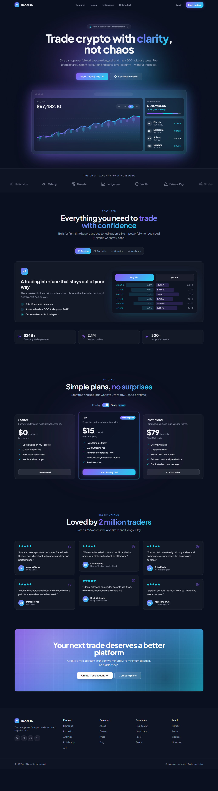

# TradeFlux — Crypto Trading Landing Page

A responsive marketing landing page for **TradeFlux**, a fictional crypto trading platform. It has a dark navy theme with a violet-to-cyan accent gradient, glassmorphism cards and subtle motion.

**Sections:** sticky navigation with a mobile menu, a centered hero with an animated gradient background and a dashboard mockup, a scrolling partner-logo strip, a tabbed features section (trading, portfolio, security, analytics), 3-tier pricing with a monthly/yearly toggle, testimonials, a call-to-action banner and a footer.

The dashboard mockup, charts and partner logos are built with inline SVG and HTML, so the project ships no image files.

## Screenshots


<p>
  
</p>

<details>
<summary>Full page</summary>



</details>

## Getting started

Requires Node.js 18 or newer.

```bash
npm install
npm run dev       # start the dev server at http://localhost:5173
npm run build     # type-check and build for production into dist/
npm run preview   # serve the production build locally
npm run lint      # lint with ESLint
npm test          # run unit tests with Vitest
```

CI runs lint, tests and the production build on every pull request (`.github/workflows/ci.yml`).

## Tech stack

- [React 18](https://react.dev) + [TypeScript](https://www.typescriptlang.org)
- [Vite](https://vitejs.dev)
- [Tailwind CSS](https://tailwindcss.com)
- [shadcn/ui](https://ui.shadcn.com) components (Button, Card, Tabs) on Radix UI primitives
- [Framer Motion](https://www.framer.com/motion/) for animations
- [Lucide](https://lucide.dev) icons
- [Vitest](https://vitest.dev) and [ESLint](https://eslint.org)
- [Plus Jakarta Sans](https://fonts.google.com/specimen/Plus+Jakarta+Sans) from Google Fonts

## Project structure

```
src/
  components/
    ui/               shadcn/ui primitives
    Navbar.tsx        sticky nav and mobile menu
    Hero.tsx          hero section
    DashboardMockup.tsx
    PartnerLogos.tsx
    Features.tsx
    Pricing.tsx
    Testimonials.tsx
    CtaBanner.tsx
    Footer.tsx
  lib/
    pricing.ts        yearly discount and billing helpers
    site.ts           brand name and nav links
    utils.ts
  index.css           theme tokens and shared utility classes
```

## Customizing

- **Brand name:** change `BRAND` in `src/lib/site.ts`, plus the `<title>` and meta tags in `index.html`.
- **Yearly discount:** change `YEARLY_DISCOUNT` in `src/lib/pricing.ts`; prices, billing notes and the toggle badge update together.
- **Colors:** `navy`, `violet`, `cyan` and the `brand-gradient` are defined in `tailwind.config.ts`.

## Accessibility

- A "Skip to content" link appears on the first <kbd>Tab</kbd> press.
- Animations and smooth scrolling are reduced when the OS "reduce motion" setting is on.
- The mobile menu exposes `aria-expanded`/`aria-controls` and closes with <kbd>Escape</kbd>.
